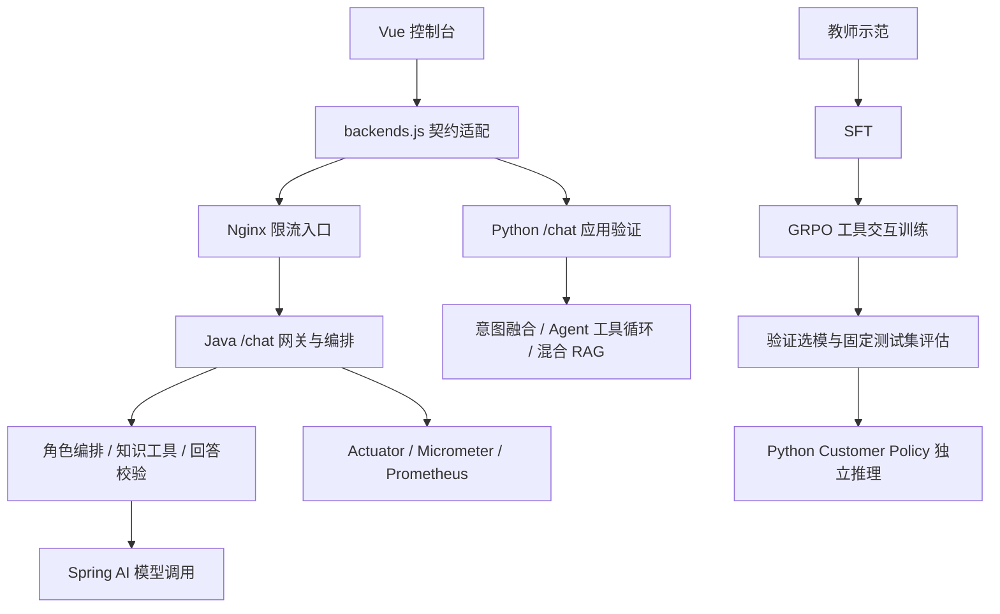

# MyMind 系统架构设计文档

MyMind 以客服政策中的检索与终止决策为研究主线，以 Python 算法引擎和 Java 网关编排展示工程实现。系统使用合成案例与个人环境演示，业务规则不代表外部平台政策。

## 职责与部署边界

| 组件 | 职责 | 当前实现 |
| --- | --- | --- |
| Python 算法引擎 | AI Native 算法开发、SFT/GRPO 训练、Customer Policy 推理、混合检索与意图融合实验 | `rl/`、`agents/customer_policy/`、`core/`、`experiments/` |
| Python 应用接口 | 为算法提供可交互的应用验证入口 | `api.main` 的 `/chat`、知识库与诊断接口，默认 8000 |
| Python 策略服务 | 加载所选模型与 LoRA，执行给定角色的单策略任务 | `api.policy_app` 的 `/requests`、`/status`，独立启动 |
| Java 网关与编排层 | 面向高并发生产场景的接入治理、多角色编排与企业监控 | Spring Boot + Spring AI、知识工具熔断、Nginx 限流、Actuator/Micrometer |
| Vue 控制台 | 同一页面调试两端的应用 HTTP 契约 | `src/lib/backends.js` 负责请求字段适配与响应归一化，默认 5173 |

Python 与 Java 当前是可独立运行的两个应用后端。Java 通过 Spring AI 调用配置的模型供应商，尚未调用 Python 策略服务；前端切换的是两端 `/chat`，不切换 Base/SFT/RL checkpoint。生产级与高并发是 Java 层的设计定位，现有实现尚无生产部署或容量压测验收。

开发时控制台也可直连 Java 8080；只有经过所配置的 Nginx 入口才受到其限流规则约束。

## 算法训练与推理闭环

`rl/teacher.py` 采集教师轨迹，`sft_data.py` 转换模型输入并构造 assistant-only 监督；system、用户、工具观察与 padding 不参与直接 loss。`sft.py` 完成 LoRA SFT，`grpo.py` 在同一任务的多条轨迹上计算奖励与优势。正式配置采用四轨迹分组、DAPO 有效模型 token 归一化、不按组标准差缩放优势、β=0。

运行时共用 `agents/customer_policy/` 的协议、检索环境与任务执行器。输入包含给定账单或技术角色、用户描述和公开材料；策略选择检索或输出结构化终止处置。私有评分标准只在评分侧读取，模型可见证据来自实际工具返回。

`api.policy_app` 启动时复用生成器和检索器，请求创建独立轨迹；同步生成移出事件循环，完整任务仍串行执行。此链路训练检索与终止策略，没有训练主辅 Agent 路由。模块细节及启动配置见[策略架构与运行](mymind/docs/agentic_rl_architecture.md)、[训练评测说明](mymind/rl/README.md)。

## 应用编排与检索

### Python 算法验证链路

`api.main` 读取记忆，经 LLM、embedding、关键词三路意图融合后形成主辅路由；`ContextBuilder` 控制上下文长度，角色 Agent 按需调用 `search_knowledge_base`。工具管理器负责查询改写、并行召回、去重、融合与重排，并返回检索状态和请求级工具轨迹。

当前知识库使用 Qwen 主向量索引、MiniLM 备用索引及 BM25；主索引故障时可返回实际备用正文，降级状态随结果记录。导入更新触发缓存失效，旧查询不能重新写入失效前的数据。Redis 保存工作记忆，Chroma 保存情景记忆、画像与知识索引；请求缓存、应用缓存和供应商 Prompt Cache 分别统计。

### Java 网关编排链路

`mymindController` 完成 DTO 校验、记忆读取和知识预取，再交由 `AgentOrchestrator` 分配 General、Technical、Billing 等角色；复合问题通过 `CompletableFuture` 并行处理，`AnswerVerifier` 检查生成回复，随后写回记忆。Java 使用自己的本地 BM25 + 字符 hash vector 检索与 LLM 重排，知识和长期记忆持久化为 JSON；不共享 Python 的 Chroma 索引或模型权重。

| 治理能力 | 实现边界 |
| --- | --- |
| 工具熔断 | `tool/CircuitBreaker` 的 CLOSED / OPEN / HALF_OPEN 状态，知识工具连续失败后暂时拒绝执行 |
| 接入限流 | `config/nginx/nginx.conf` 按客户端 IP 配置 10 请求/秒、burst 20 和连接限制；不是 CircuitBreaker 的职责 |
| 并行编排 | Agent 与检索子任务使用 CompletableFuture；当前使用默认线程执行资源 |
| 监控反馈 | `PerformanceMonitor` 采集成功率、延迟和路由惩罚，Actuator/Micrometer 暴露 Prometheus 指标 |

回答校验、熔断和规则路由属于应用工程贡献，不计为 SFT/RL 收益。两端检索和编排策略不同，公共 HTTP 契约不意味着模型行为或召回质量等价。

## 前端契约

差异集中在 `mymindFrontend/src/lib/backends.js`；页面消费统一的 camelCase 对象，原始响应保留在 `raw` 中。Java 的 Jackson 配置为 SNAKE_CASE。

| 操作 | Python 线格式 | Java 线格式 | 页面契约 |
| --- | --- | --- | --- |
| POST /chat | message、user_id、conv_id | message、user_id、conversation_id | message、userId、conversationId |
| 聊天响应 | conv_id、agent_type、latency_ms | conversation_id、agent_type、latency_ms | conversationId、agentType、latencyMs |
| POST /search | query、top_k 查询参数 | query、topK 查询参数 | query、topK |
| 知识导入 | documents 数组 | documents 数组 | title、content |
| 文件上传 | multipart 字段 file | multipart 字段 file | 同一上传方法 |
| 健康与监控 | /health、/monitor、/knowledge/stats | 同名端点 | 通用状态区；完整监控结构保留后端差异 |

Python 额外提供细粒度路由、工具轨迹与 RAG 状态；Java 返回 verified、grounded。缺少的诊断字段不构成等价能力证明。切换后端清空当前会话和聊天展示，避免把一个后端的会话当成另一个后端的上下文；正在发送消息时暂停切换。

## 证据与限制

固定合成 120 题上，Base/SFT120/RL40 的完整成功为 0/43/43，严重错误为 38/38/27，协议错误为 76/24/19。RL 新增 3 道成功并失去 3 道，完整成功率未提升。单 seed、有限题集不支持泛化或稳定收益结论；正式测试未观察到补检。

公开仓库提供代码、小型开发资源、测试和结果摘要。正式数据、私有标准、训练轨迹、模型和索引单独保存。离线测试验证程序行为，不代替 GPU 训练、真实服务或高并发验收。

## 领域语言

**客服任务**：用户提出的一项需要解决的咨询或处置请求。它可以包含多个相关条件，完成任务可能需要多次获取证据。

**任务实例**：用户描述、业务条件和处理要求已经具体化的一道客服任务。同一任务的多条采样轨迹不构成多个任务实例。

**业务主题**：按用户问题内容划分的业务类别，例如退款到账或接口权限排查。一个主题可包含多个条件结构与证据依赖不同的场景族。

**实验业务规则**：为 MyMind 受控客服实验制定、经确认后用于判断任务的政策与处置边界。它们描述实验采用的业务设定，不代表真实外部平台的政策。

**场景族**：共享核心业务条件结构与证据依赖的任务集合。话术改写和非决定性细节变体属于同一场景族。

**决定性条件组合**：共同决定业务结论、必要事实或下一步的一组业务条件及其已知情况，例如渠道、处理阶段与相对时限的关系，或接口、开通与白名单状态。
_Avoid_：将更换标识、措辞或同一判定区间内的数值视为新的条件组合。

**可观察信息**：处理任务时实际能够获得的信息，包括用户请求及其提供的订单或日志摘要、角色规范与工具返回的知识材料。
_Avoid_：将未提供且无法检索的后台状态当作策略应当知道的事实。

**用户自述事实**：用户在请求或附带材料中提供的情况说明，可以用于解释政策和判断下一步；其本身不等同于后台已完成核验。

**退款处理阶段**：退款从申请受理、审核到渠道处理等不同环节所处的状态。判断处理时效需要先明确阶段及其适用规则。

**退款申请受理**：退款申请已被接收的状态，不代表审核已经通过，也不能单凭这一状态认定已开始计算到账时限。

**退款记录**：一笔既有退款的情况描述，具有独立标识、原支付渠道、审核状态及其已知计时信息。同一咨询可以涉及多笔退款，各笔分别适用规则和计算时效。

**权限处理主体**：按适用业务规则有权执行某项配置或权限开通的用户或平台人工。用户可自助处理与必须平台人工处理的事项分别判断。

**项目访问白名单**：实验接口用来限定允许访问的请求出口地址的集合，由具备项目配置权的用户调整。

**接口能力**：业务接口对应的操作类别，决定该接口适用的访问条件。本实验中基础查询与报表预览属于基础查询能力，报表导出与批量报表生成属于导出能力。

**平台功能开通**：平台授权指定项目在指定运行环境中使用某项业务功能的状态。本实验中的导出能力开通由平台人工处理，独立于用户侧白名单配置。

**政策适用范围**：政策明确覆盖的业务对象、条件与事项边界。范围外不能直接套用其中的规则；缺少某事项的规定，不等于禁止该业务本身。

**适用依据缺失**：业务信息已经充分，但知识材料没有提供覆盖该情况的业务规则。
_Avoid_：将未检索到已有规则或工具故障等同于适用依据缺失。

**业务角色**：任务处理所采用的专业职责与回答要求。账单角色负责账单及售后咨询，技术角色负责技术支持；角色区别不要求使用独立的模型参数。

**业务路由**：将客服任务分配给适当业务角色的决定。
_Avoid_：将已有路由给定的角色标签称为策略学会选择 Agent。

**跨域共享策略**：共同用于账单和技术任务的检索与终止决策方式；角色与任务内容作为已知上下文。

**任务内多轮交互**：处理同一客服任务时，策略多次提出查询并接收工具返回的过程。
_Avoid_：将其称为多轮用户对话或多 Agent 协作。

**检索与终止策略**：根据用户请求和已获得的证据，选择查询、补充检索、回答或升级的决策方式。
该策略也可以在必要信息缺失时请求补充信息，作为当前任务的终止处置。

**观察驱动的检索决策**：依据实际获得的材料判断证据是否充分，并据此决定停止检索或继续查询，以及下一次查询的目标。
_Avoid_：仅凭搜索次数增加，认定策略利用了工具反馈。

**首检证据充分**：第一次检索返回的可见材料已覆盖当前业务判断所需的适用规则与依据，可以结合用户提供的信息形成结论。取得充分材料本身不等于已经正确完成任务。

**观察依赖补检**：当前材料尚不足以支持完整结论，下一次查询所需的新线索在先前工具观察中才被揭示的补充检索。

**请求补充信息**：明确指出继续处理所缺少的必要信息，并结束当前任务。当前实验不包括收到用户补充后继续对话。

**主要终止处置**：结束当前任务时采用的主要处理决定，包括回答、请求补充信息或升级人工。说明与待补材料可以附属于该决定，不要求成为多个并列处置。

**判断对象**：一项事实、理由、建议或待补信息所针对的具体退款记录、请求或配置记录。单个咨询可以涉及多个判断对象，各项判断分别对应对象，再形成整个咨询的主要终止处置。

**处置理由**：支持所选主要处置的业务判断，例如缺少平台开通或决定性状态未知。它需要结合用户情况和适用规则成立，不等同于已经查明技术根因。

**待补信息**：继续判断所缺少的必要情况，或人工核查仍需提供的材料。已经具备升级条件时，材料尚未齐全不延迟升级决定。

**升级决定**：策略判断任务需要人工介入并给出处置说明的结果。
已经能够确定需要人工处理时，可以同时列出人工处理所需的待补材料。
_Avoid_：将升级决定等同于工单已创建或业务操作已执行。

**任务轨迹**：从接收客服任务到给出最终处置之间，按顺序记录的策略动作和工具返回。

**业务结论**：针对客服任务给出的处置决定及其成立条件，包括支持该决定的关键事实和证据。

**结构化业务事实**：采用明确业务类型与取值表达的事实或条件，用于说明业务结论；内容仍需符合实际情况及适用范围。
_Avoid_：将字段存在、取值合法等同于业务正确。

**证据支持**：引用的业务材料能够支持结论中的具体事实或条件；仅出现材料编号不构成证据支持。

**查询改写**：将用户请求及已有证据转换为更适合检索的查询表达，包括补足上下文、保留适用条件与聚焦尚缺信息。

**知识检索**：根据查询，从客服政策与支持材料中取得可用于判断任务的相关内容，例如退款时限、权限要求和故障处理规则。取得材料之后，仍需结合用户情况判断其是否适用以及是否充分。

**候选重排**：对已检索出的材料重新排序，优先提供与当前查询有关且适用的证据。

**人工核查**：用户对照业务规则、代码或原始证据，检查方案、实现、任务、答案与评分并作出判断；可以使用新会话中的其他 AI 模型辅助。该过程在训练之外进行。

**训练奖励**：依据任务目标，对策略产生的轨迹计算的数值反馈，用于策略参数更新。它与审查训练实现是否正确是两项不同工作。

**完整成功**：主要处置合理，必要事实与条件完整且正确，证据支持充分，并遵守业务操作与核验边界的任务结果。

**严重业务错误**：错误适用决定性规则、将未知业务状态当成已确认事实，或作出虚假的核验、操作与结果承诺。它不同于遗漏必要说明或尚未形成可用结论。

**部分得分**：对尚未完整成功、但已正确完成部分业务要求的结果给予的有限反馈。它不等同于任务成功。
